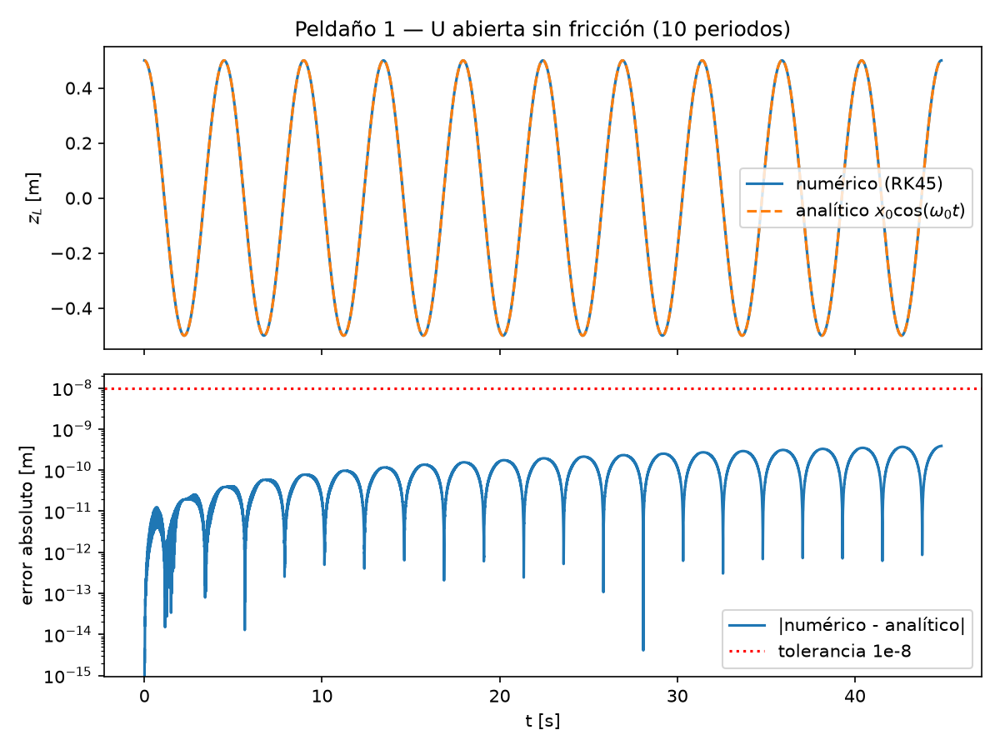
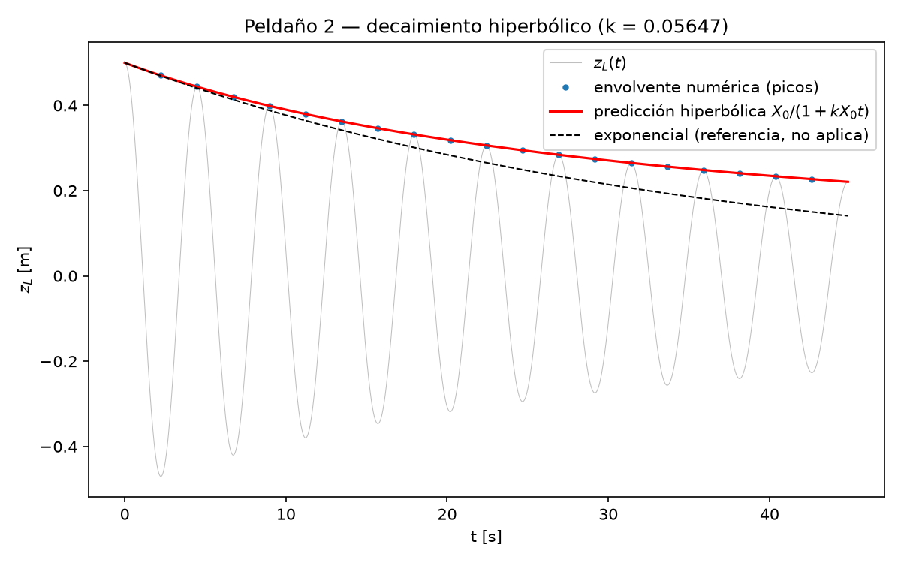

# U-Tube Inertial Evaporator — 0D Dynamic Model

A lumped-parameter (0D) dynamic model of an **inertial evaporator**: an oscillating
liquid column (a liquid piston) in a U-tube, with a closed vapor chamber above one leg.
As the column swings down, the chamber expands and depressurizes; the liquid becomes
superheated and flashes (flash evaporation / cavitation). As the column returns, the
liquid piston recompresses the vapor and expels it, superheated, through a check valve.
Heat is supplied as **low-temperature industrial waste heat (20–95 °C)**.

The goal is a model that predicts COP as a function of source temperature, drive
frequency, and geometry, built from first principles and checked at every stage against
analytical limits, conservation laws, and the second law.

## Motivation and scope

This is a portfolio project built ahead of an R&D Engineer application to
[Hydram Research](https://hydram.is) (Iceland), whose product is essentially this
device at industrial scale. The differentiating goal here is **numerical rigor**, not
device engineering: closed-form checks, regression tests, and measured performance,
rather than a from-scratch thermodynamic design.

**This is explicitly not a CFD project.** The device is modeled as a system of 6
coupled ODEs (lumped parameters), not a meshed, resolved two-phase flow. Any drift
toward OpenFOAM-style bubble-resolved simulation is out of scope (see
[Future work](#future-work)).

## Physics, in brief

U-tube of constant cross-section `A`. The left leg is closed at the top by a sealed
vapor chamber (roof at height `H`); the right leg is open to atmosphere `p_0`.

Momentum balance (drives the oscillation):

$$ L \cdot \frac{d^2z_L}{dt^2} = g \cdot (z_R - z_L) - \frac{p_v - p_0}{\rho} - c \cdot \frac{dz_L}{dt} \left| \frac{dz_L}{dt} \right| + \frac{F_{\text{drive}}}{\rho \cdot A} $$

The drag term is $\dot z_L \lvert \dot z_L \rvert$, not $\dot z_L^2$ — it must switch
sign with the flow direction, or the column gains energy on the return half-cycle
(see the [step 2 damping check](#verification-highlights-steps-12)).

State vector at full fidelity (6 components — level, velocity, vapor mass/energy,
liquid mass/energy):

$$ y = \begin{bmatrix} z_L & \dot z_L & m_v & U_v & m_l & U_l \end{bmatrix} $$

Temperature and pressure are **never** states — they are always derived from the
equation of state applied to the integrated (conserved) quantities. See
[`CONTEXT.md`](CONTEXT.md) *(internal design notes, not tracked in this repo)* for the
full derivation, the algebraic closure block, and the phase-change and discharge
models.

## Build ladder

The model is built incrementally. Each step adds one piece of physics and has its own
closed-form or conservation-based acceptance test — no step is implemented until it has
a numeric pass/fail criterion.

| # | Step | States | Verification | Status |
|---|------|:---:|---|:---:|
| 1 | Open U-tube, frictionless | 2 | exact analytical solution, isochronism | ✅ |
| 2 | Quadratic friction | 2 | hyperbolic decay envelope | ✅ |
| 3 | Adiabatic ideal-gas chamber | 2 | energy conserved; predicted frequency | ⬜ |
| 4 | Real vapor (CoolProp), fixed mass | 3 | converges to step 3 at low pressure | ⬜ |
| 5 | Phase change | 6 | mass, energy, `S_gen ≥ 0` | ⬜ |
| 6 | Discharge, open cycle | 6 | steady-periodic COP | ⬜ |

## Verification highlights (steps 1–2)

**Step 1 — undamped column vs. exact solution.** `x(t) = x0·cos(ω0·t)`, integrated with
`RK45` at `rtol=1e-10, atol=1e-12`. Max error over 10 periods stays around `1e-10 m`
(two orders of magnitude below the `1e-8 m` acceptance bound), and specific energy is
conserved to the same order.



**Step 2 — quadratic drag gives hyperbolic, not exponential, decay.** This is the
signature check for quadratic (vs. linear) damping: averaging `de/dt = -c·|v|³` over a
cycle gives `X(t) = X0 / (1 + k·X0·t)`, not `X0·e^(-kt)`. With the reference geometry
(`k = 0.05647`), the column loses about 80% of its energy in 10 periods — damping is
the dominant term in the momentum balance, not a second-order correction.



Both figures (plus energy-balance plots) are regenerated on demand — see
[Reproducing the figures](#reproducing-the-figures).

## Getting started

Requires [conda](https://docs.conda.io/) (Windows/Linux/macOS).

```bash
conda env create -f environment.yml
conda activate hydram
pip install -e .
```

### Running the tests

```bash
pytest -v
```

Each build-ladder step has its own test module (`tests/test_step*.py`). A regression in
an earlier step's test while working on a later one points to a real bug, not a stale
assumption — see [`CONTEXT.md`](CONTEXT.md) for the acceptance numbers behind each
assertion.

### Reproducing the figures

```bash
python scripts/run_step1.py
python scripts/run_step2.py
```

Figures are written to `figures/` (git-ignored, regenerated from source — the copies
under `assets/` are the ones checked into the repo for this README).

## Repository layout

```
hydram/
├── environment.yml
├── pyproject.toml
├── src/utube/
│   ├── column.py        # frozen dataclass: geometry + derived quantities
│   └── dynamics.py      # rhs, specific_energy, simulate
├── tests/
│   └── test_step1.py    # steps 1-2: analytic match, energy, isochronism, damping
├── scripts/
│   ├── run_step1.py     # figures for step 1
│   └── run_step2.py     # figures for step 2
└── assets/              # figures committed for this README
```

`Column` is `frozen=True` so a simulation run can never mutate its own parameters
mid-integration.

## References

- Van de Ven, J.D. & Li, P.Y., "Liquid piston gas compression," *Applied Energy*
  86(10), 2009 — the foundational liquid-piston model this device's skeleton follows.
- Carey, V.P., *Liquid-Vapor Phase-Change Phenomena* — interfacial kinetics
  (Hertz–Knudsen–Schrage), the reference for the phase-change closure.
- Brennen, C.E., *Cavitation and Bubble Dynamics* — Rayleigh–Plesset, ch. 2.
- Bejan, A., *Advanced Engineering Thermodynamics* — entropy generation in open
  systems, underpinning the `S_gen ≥ 0` check in step 5.
- Bell, I.H., Wronski, J., Quoilin, S. & Lemort, V., "Pure and Pseudo-pure Fluid
  Thermophysical Property Evaluation and the Open-Source Thermophysical Property
  Library CoolProp," *Ind. Eng. Chem. Res.* 53(6), 2014.
- Hairer, E. & Wanner, G., *Solving ODEs II: Stiff and DAE Problems* — Radau IIA, used
  from step 4 onward once the vapor dynamics introduce stiffness.

## Author

Miguel Ángel Rodríguez García — ma.rodgar1999@gmail.com
