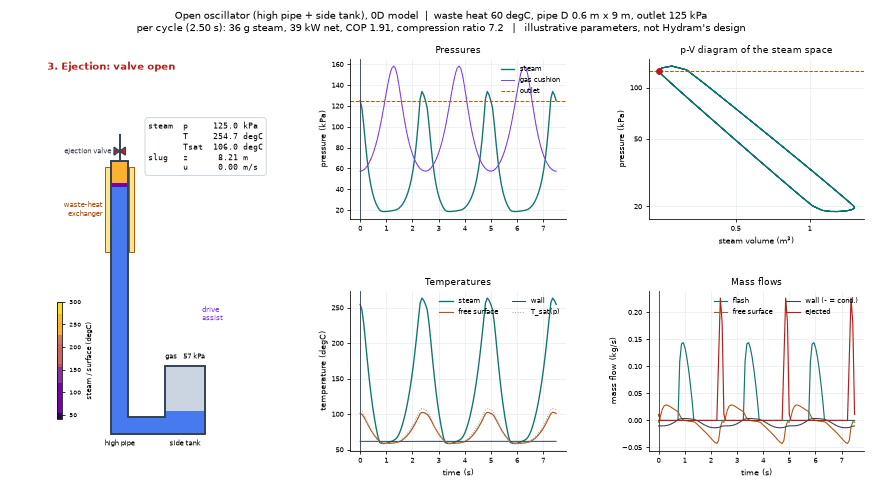
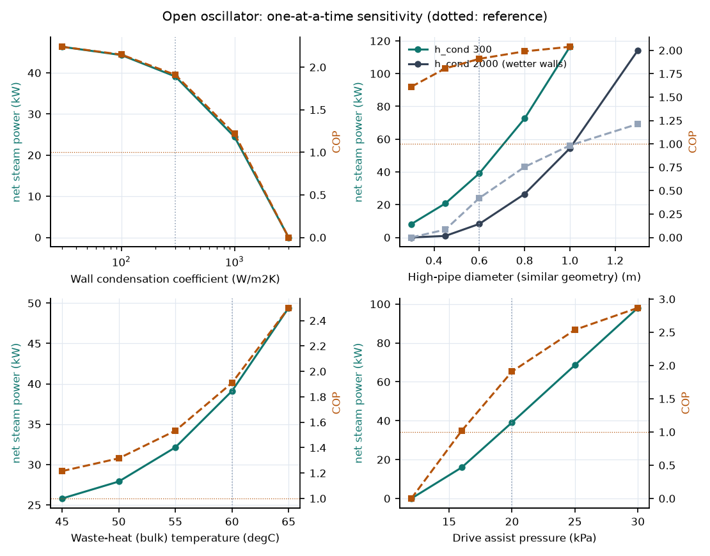
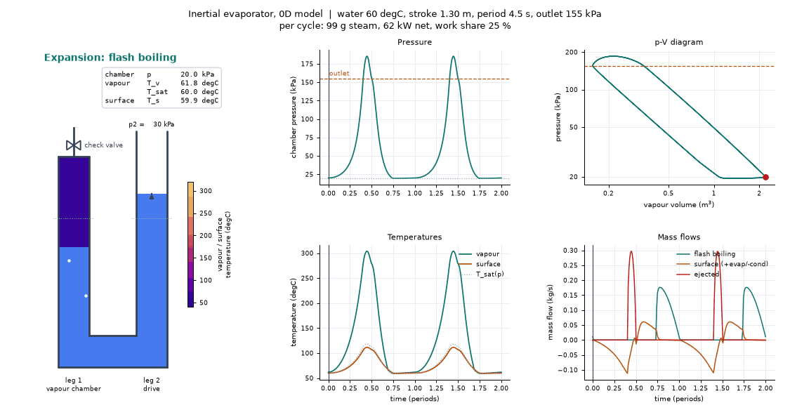
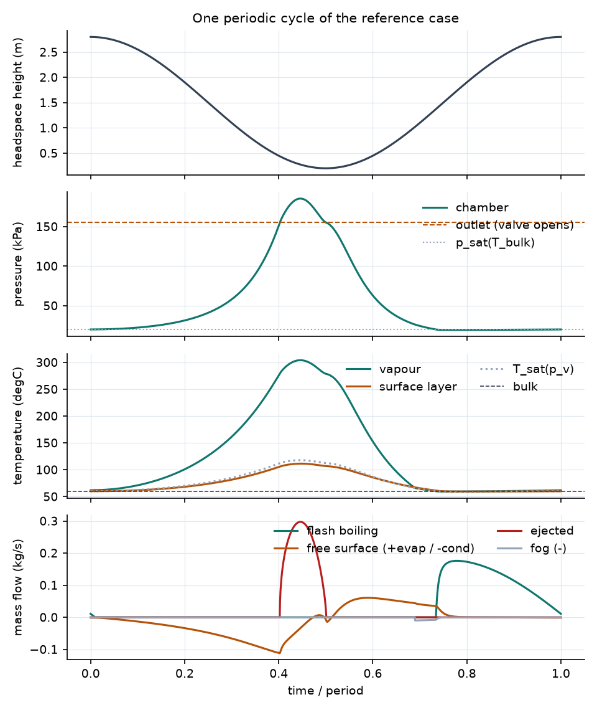
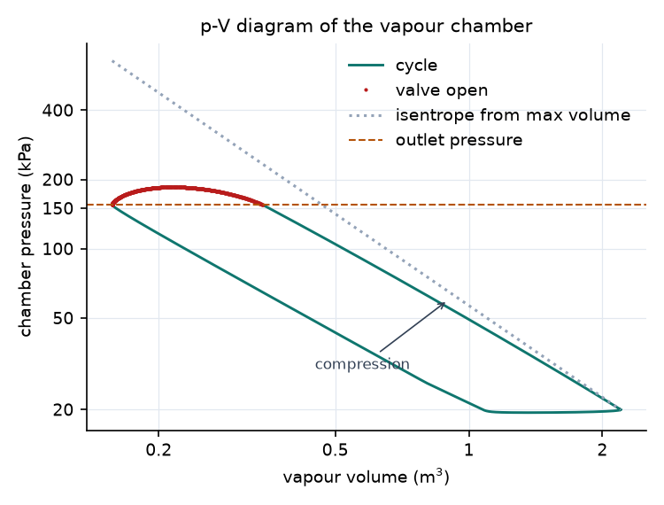
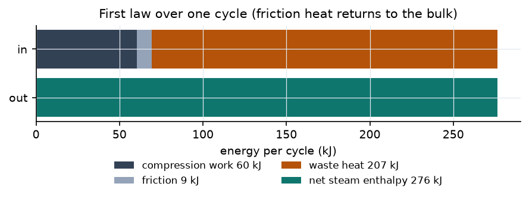
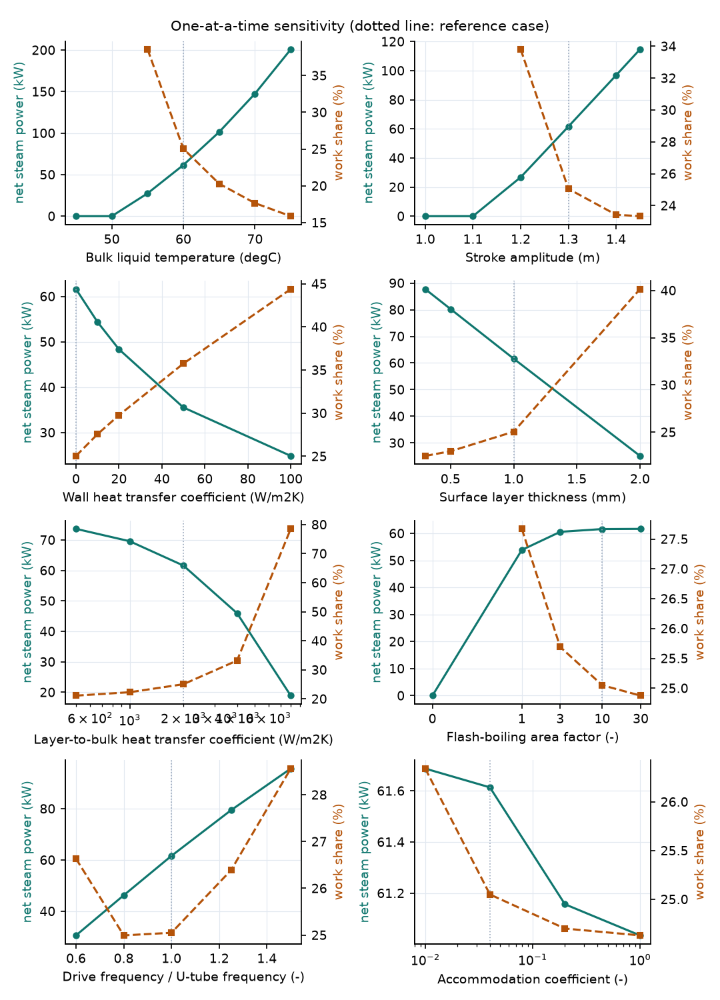
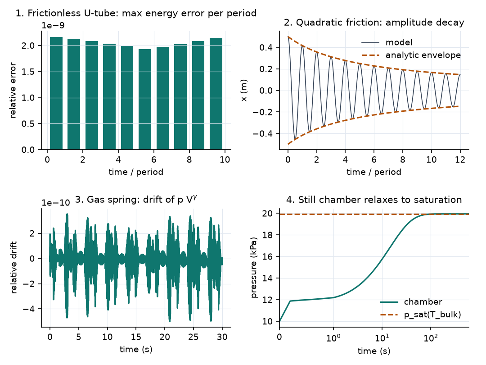

# liquid-piston-0d

Zero-dimensional models of liquid-piston steam generators (inertial
evaporators): a column of warm water oscillates, flashes into a low-pressure
steam space when it falls, compresses that steam when it rises, and ejects it
through a check valve above the outlet pressure.

The repository contains two models that share the same property and valve
code:

| Model | Architecture | Package |
| --- | --- | --- |
| **Open oscillator** | Tall high pipe with the steam space at the top, wide side tank with a gas cushion, oscillation sustained by an assist pressure | `liquid_piston.open_oscillator` |
| **U-tube** | Symmetric U-tube with a closed vapour chamber, motion prescribed or pressure-driven | `liquid_piston.utube` |

The open oscillator follows the architecture Hydram Dynamics describes publicly
(https://hydram.is/technical). Both models are independent learning and
exploration tools built only from public information: geometries and
parameters are illustrative, **not** Hydram's design, and the results have not
been validated against measurements.



*Open oscillator, reference case: the slug moves between the high pipe and the
side tank, flashes on the way down, compresses the steam on the way up and
ejects it through the check valve.*

## Repository layout

```
src/liquid_piston/
    properties.py            IAPWS-IF97 saturation + consistent caloric model (shared)
    valve.py                 compressible orifice flow for the ejection valve (shared)
    open_oscillator/
        model.py             parameters, slug dynamics, steam space, simulate()
        analysis.py          energy bookkeeping, per-cycle metrics, COP, second law
        cases.py             reference case, geometric scaling
    utube/
        model.py             parameters, drives, column and vapour chamber, simulate()
        analysis.py          energy/mass balances, per-cycle metrics, second law
        cases.py             reference case
scripts/
    open_oscillator/         run_study.py, make_figures.py, animate.py
    utube/                   run_study.py, make_figures.py, animate.py
tests/
    common/                  properties and valve
    open_oscillator/         conservation, frequency, reference cycle, wall finding
    utube/                   verification ladder, rungs 1 to 6
results/{open_oscillator,utube}/   reference.txt, reference.json, sweeps.json
figures/{open_oscillator,utube}/   animations and figures
docs/physics/                physics notes with all principles and equations (LaTeX, in Spanish)
```

Both subpackages expose the same kind of interface:

```python
from liquid_piston.open_oscillator import REFERENCE, simulate, cycle_metrics

res = simulate(REFERENCE, t_end=60.0)
print(cycle_metrics(res).summary())
```

```python
from liquid_piston.utube import REFERENCE, reference_drive, run_to_periodic, cycle_metrics

res = run_to_periodic(REFERENCE, reference_drive(), n_cycles=15)
print(cycle_metrics(res).summary())
```

## Quick start

```bash
conda env create -f environment.yml   # creates the "hydram" environment, Python 3.12
conda activate hydram
pytest                                # 42 tests, ~80 s

python scripts/open_oscillator/run_study.py     # reference case + sweeps, ~5 min
python scripts/open_oscillator/make_figures.py
python scripts/open_oscillator/animate.py       # -> figures/open_oscillator/animation.mp4

python scripts/utube/run_study.py               # ~4 min
python scripts/utube/make_figures.py
python scripts/utube/animate.py                 # -> figures/utube/animation.mp4
```

The animation scripts take the main operating parameters on the command line
(for example `--t-bulk 65 --h-cond 2000` for the open oscillator, or
`--t-bulk 70 --stroke 1.4` for the U-tube), and `--show` opens an interactive
window instead of saving a file. The GIFs shown in this README are rendered
with `--out figures/<model>/animation.gif`.

## Shared building blocks

- **Saturation properties** follow IAPWS-IF97 region 4, checked against the
  standard's verification values and CoolProp.
- **Caloric model:** incompressible liquid and ideal-gas vapour with constant
  specific heats and a single enthalpy reference, chosen so the latent heat is
  exact at 100 °C and within 1 % of steam tables from 7 to 127 °C. A shared
  reference is what lets the energy balances close to integrator precision.
- **Ejection valve:** isentropic orifice flow, subsonic or choked, no reverse
  flow.

## Open oscillator

A liquid slug oscillates between a tall high pipe, whose top holds the steam,
and a wide side tank with a gas cushion. It follows the modelling route Hydram
suggests: slug kinematics, the side-tank gas bubble and the steam in the high
pipe, coupled and stepped in time.

- **Energy-based slug dynamics.** The inertia M(z) changes as liquid moves
  between sections of different area; the Lagrangian term 1/2 M'(z) u^2 keeps
  energy conserved (checked to 1e-9 in the conservative limit).
- **Direction-dependent losses:** entrance loss into the high pipe, Borda-Carnot
  exit loss into the tank, friction and bends.
- **Gas cushion** in the side tank (adiabatic ideal gas).
- **Steam space** with flash boiling, free-surface evaporation and condensation
  (Hertz-Knudsen-Schrage plus a surface layer), fog, and **wet-wall phase
  change** with an effective coefficient `h_cond` and a heated wall node.
- **Feedback drive** `P_assist * tanh(u / u_ref)`, so stroke and period come out
  of the dynamics.

Reference case (0.6 m x 9 m pipe, water at 60 °C, outlet 125 kPa): a 2.5 s
limit cycle, compression ratio 7.2, 36 g of steam per cycle (39 kW net) and
COP 1.9. Hydraulic losses take 60 % of the drive work.



*One-at-a-time sensitivity of net steam power and COP to the wall condensation
coefficient `h_cond`, the high-pipe diameter (similar geometry, for two values
of `h_cond`), the waste-heat temperature and the assist pressure. Dotted lines
mark the reference case.*

- **Wall condensation is the dominant uncertainty.** Output falls steeply with
  `h_cond` and stops between 1,000 and 3,000 W/m²K. Clean film condensation on
  bare steel would be higher still, so the real effective value is something
  to calibrate against measurements.
- **Bigger pipes work better.** With strongly wetted walls a 0.3 m pipe never
  ejects and COP only passes 1 near 1 m, which agrees qualitatively with
  Hydram's remark that the system needs to be large.
- Warmer waste heat and a stronger assist both raise output and COP.

## U-tube

A symmetric U-tube whose leg 1 ends in a closed vapour chamber. The cycle study
prescribes the column motion (kinematic drive) so stroke and frequency are
controlled exactly; a pressure drive is also available.



*U-tube, reference case: schematic with vapour and surface temperatures (left),
and chamber pressure, p-V loop, temperatures and mass flows over two periodic
cycles (right).*

| Sub-model | Approach | Switch |
| --- | --- | --- |
| Column dynamics | Rigid column, hydrostatic restoring force, quadratic friction | `K_loss` |
| Drive | Prescribed pressure on leg 2, or prescribed motion with the required pressure computed | `PressureDrive` / `KinematicDrive` |
| Free-surface phase change | Hertz-Knudsen-Schrage | `sigma`, `area_factor` |
| Surface layer | Thin liquid layer with its own temperature, coupled to the bulk | `delta`, `h_bulk` |
| Flash boiling | One-way HKS evaporation from bubble interfaces below p_sat(T_bulk) | `cav_area_factor` |
| Fog | Relaxation of supersaturated vapour back to saturation | `fog_tau` |
| Chamber walls | Sensible heat exchange only | `h_wall` |
| Ejection valve | Shared valve model | `valve_area`, `valve_cd`, `p_out` |

Reference case (7.7 t of water at 60 °C, outlet 155 kPa): 99 g of steam per
4.5 s cycle (62 kW net), 25 % of the steam energy supplied as work,
second-law efficiency 63 %.



*Time traces over one periodic cycle.*



*p-V diagram of the vapour chamber. Compression stays just below the isentrope
from maximum volume; the valve is open (red) while the chamber is above the
outlet pressure.*



*First law over one cycle: 60 kJ of compression work and 9 kJ of friction heat
plus 207 kJ of waste heat leave as 276 kJ of net steam enthalpy.*



*One-at-a-time sensitivity of net steam power and work share to bulk
temperature, stroke, wall and layer-to-bulk heat transfer, surface layer
thickness, flash-boiling area, drive frequency and accommodation coefficient.
Dotted lines mark the reference case.*

1. **Free-surface evaporation alone cannot refill the chamber**; bulk flash
   boiling is necessary, and the result saturates once the bubble interface is
   a few times the pipe cross-section.
2. **The main loss is condensation back onto the free surface**, controlled by
   how fast the surface heats up, not by interface kinetics.
3. **There are clear thresholds** in bulk temperature (between 50 and 55 °C)
   and stroke (between 1.1 and 1.2 m) for this geometry.
4. **Walls set the superheat:** adiabatic walls give steam near 300 °C.

## Verification

Each step adds one piece of physics and is checked against something that does
not come from the model itself. The energy checks are written independently of
the right-hand sides, so a sign or reference error shows up as a closure error.

| Test set | Check |
| --- | --- |
| `common/` | IAPWS-IF97 verification values, CoolProp, choked and incompressible valve limits |
| `utube/` rung 1 | Frictionless period 2π√(L/2g) to 1e-5; energy conserved to 1e-6 |
| `utube/` rung 2 | Quadratic-friction decay against the energy-method envelope (3 %) |
| `utube/` rung 3 | Gas spring: p V^γ constant, small-amplitude frequency to 1e-4 |
| `utube/` rungs 4-5 | Relaxation to p_sat; evaporative cooling; mass and energy balances close |
| `utube/` rung 6 | Full cycle: first and second law, periodicity, solver-tolerance convergence |
| `open_oscillator/` | Conservative limit to 1e-9 (variable inertia), linearised frequency, reference limit cycle, first and second law, small-pipe finding |



*Rungs 1 to 4: energy error of the frictionless U-tube, friction decay against
the analytic envelope, drift of p V^γ in the gas spring, and relaxation of a
still chamber to p_sat.*

## Physics notes

`docs/physics/fisica_evaporador_inercial.tex` (and the compiled PDF) derives
every principle used here, in Spanish: unsteady Bernoulli and the Lagrangian
with variable inertia, hydraulic losses, the gas cushion, saturation and
Clausius-Clapeyron, open-system energy balances, flash evaporation and the
Jakob number, Hertz-Knudsen-Schrage kinetics, transient conduction and wall
condensation, Rayleigh-Taylor instability, compressible valve flow, and the
energy and exergy bounds on COP. Compile with XeLaTeX.

## Limitations

- Lumped (0D): no pressure waves, sloshing, stratification or spatial
  temperature fields in the steam.
- Flash boiling, surface layer, fog and wall condensation are effective
  sub-models whose parameters would have to be fitted to experiments.
- No non-condensable gas in the steam space.
- Ideal-gas vapour (within 2 % of real steam density at the operating points).
- Valve dynamics (mass, spring, opening time) are not modelled.

## Next steps

1. Calibrate the effective parameters, starting with `h_cond`, against measured
   pressure and temperature traces.
2. Non-condensable gas in the steam space.
3. Steam attemperation (spray) to limit superheat.
4. Valve dynamics and header pressure fluctuations.

Author: Miguel Ángel Rodríguez García
